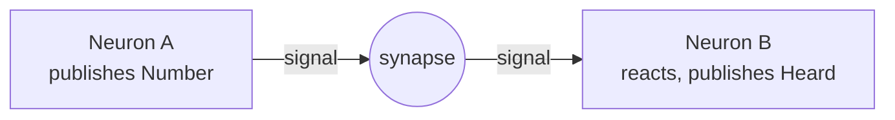

# IntoChat OS

[](https://github.com/intochat/os/actions/workflows/ci.yml)
[](LICENSE)

A runtime for AI apps and agents, built on .NET, Orleans and Aspire.

## How it works

Everything in the runtime is a **neuron**, a **signal** or a **synapse**.

- **Neuron**: a stateful, addressable capability that lives in a brain (an ownership scope): a timer, an inbox, a running program. Durable state lives in neurons, never in a process.
- **Signal**: a typed fact a neuron publishes. Signals are the only thing that flows between neurons. The runtime stamps each one with its publisher, so provenance cannot be forged.
- **Synapse**: the durable routing of a signal kind from one neuron to another; it survives restarts.

The rest of the vocabulary:

- **Reaction**: a script method that runs when a signal arrives (shape checked by RXN0001/RXN0002).
- **Module**: the unit of code; one folder with Contracts, internal neurons, tests and one static ModuleManifest.
- **Capability**: a versioned contract (storage@1) a module provides and an app requires.
- **Connection**: a person's authorised use of a module in a brain; apps never pick a module, the broker resolves connections.
- **Topology**: local, local+cloud or cloud; one topology profile class each.



A neuron is an Orleans grain that derives from `Neuron`. This shape is taken from the integration tests: an emitter publishes `Number` signals, and a listener subscribes to them and publishes `Heard` in response.

```csharp
[GenerateSerializer] public sealed record Number([property: Id(0)] int Value) : Signal;
[GenerateSerializer] public sealed record Heard([property: Id(0)] int Value) : Signal;

[Alias("test.emitter")]
public interface ITestEmitter : INeuron { Task Emit(int value); }

[GrainType("test-emitter")]
public sealed class TestEmitter : Neuron, ITestEmitter
{
    public Task Emit(int value) => PublishAsync(new Number(value));
}

// Inside another neuron: subscribe to the emitter's Number signals.
var source = ServiceProvider.GetRequiredService<IIntoChatOS>().Get<ITestEmitter>(sourceId);
var subscription = await ServiceProvider.GetRequiredService<IBrainSubscriptions>().SubscribeAsync<Number>(source);
await foreach (var number in subscription.ReadAllAsync()) { await PublishAsync(new Heard(number.Value)); }
```

Full listings: [`TestNeurons.cs`](src/IntoChat.OS.Client/IntoChat.OS.Client.Orleans.Tests.Integration/TestNeurons.cs). Contracts: [`INeuron`](src/IntoChat.OS/Neurons/INeuron.cs), [`Signal`](src/IntoChat.OS/Signals/Signal.cs), [`Synapse`](src/IntoChat.OS/Synapses/Synapse.cs).

## Quick start

Prerequisites: the .NET SDK pinned in [`global.json`](global.json) (.NET 11 preview), Docker (Linux containers) and, for the local profile, [Ollama](https://ollama.com) running on the host.

```
dotnet run intochat-os.cs preflight   # check the machine, change nothing
dotnet run intochat-os.cs local       # start a lean profile against host Ollama
dotnet run intochat-os.cs             # default profile, includes the Flutter shell
```

Run from the repository root. Profiles and options are described in the header of [`intochat-os.cs`](intochat-os.cs).

## Module model

A module is a folder and a `Module` class. Create one with `dotnet new intochat-module`; adding it needs zero edits outside its folder, because the catalog discovers modules by reflection. Every module README lists its options and secret names from the code that binds them (generated by `dotnet run scripts/module-readmes.cs`). See [modules](https://github.com/intochat/os.docs/blob/main/modules.md).

## Run your own circle

IntoChat OS is MIT licensed, and the circle server module ships in this repository, so anyone can run their own circle by starting the kernel with `IntoChatOS:Topology=cloud`. Machines join it with an invite code and connect with a key-bound circle credential. intochat.io is the IntoChat circle, the one that hosts the IntoChat store. See [circles](https://github.com/intochat/os.docs).

## Packages and images

- NuGet packages (GitHub Packages): `https://nuget.pkg.github.com/intochat/index.json`
- Container images: `ghcr.io/intochat/os` (kernel), `ghcr.io/intochat/os-ui` (Flutter web shell), `ghcr.io/intochat/os-sandbox` (C# sandbox)

Releases are tagged `v<VERSION>` from the [`VERSION`](VERSION) file. See the [changelog](CHANGELOG.md).

## Documentation

Concepts, architecture and guides: [intochat/os.docs](https://github.com/intochat/os.docs).

## Contributing and license

See [CONTRIBUTING.md](CONTRIBUTING.md) and [SECURITY.md](SECURITY.md). Licensed under the terms in [LICENSE](LICENSE).
