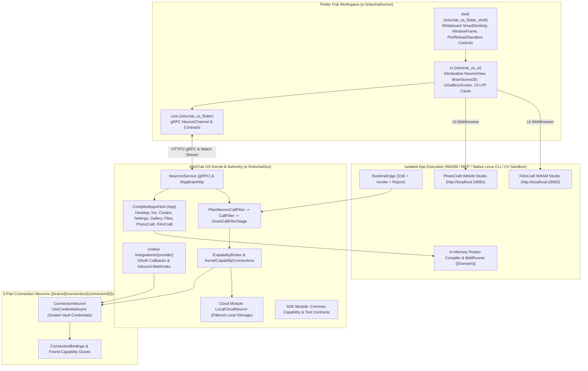
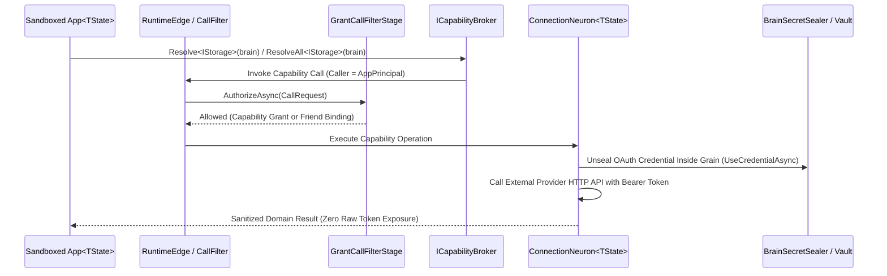

# IntoChat OS — Comprehensive Finalization Plan Specification

## 1. Executive Summary & Architectural Vision

This document specifies the end-to-end architecture, component contracts, security model, phase breakdown, and verification pipeline for finalizing **IntoChat OS** (`e:\intochat\os`) and its companion framework (`e:\intochat\digitalbrain`) and modules (`e:\intochat\modules`).

The finalization unifies six foundational pillars:
1. **Consolidated Flutter UI Workspace & Single Declarative Toolkit (`R2`)**: Relocating all Flutter packages (`core`, `ui`, `shell`) into a clean Dart Pub workspace at `e:\intochat\os\ui\` (isolated from MSBuild/`.slnx` drift) and standardizing all built-in and runtime apps on `DigitalBrain.UI` + `App<TState>`.
2. **Whiteboard Home Desk with Smart Sticky-Note Apps & Pinning (`R3`)**: Transforming the desktop home surface into an infinite/smart whiteboard where apps operate as resizable sticky-note cards and windows that auto-arrange while respecting pinned (`LucideIcons.pin`) always-on-top locks.
3. **Window Top Bar Controls, Sandbox Execution Modes & WASM Studios (`R4`)**: Adding short-click view reload and long-press (`> 500ms`) hard sandbox restart (`LucideIcons.rotateCw`), per-app execution mode switching (`WASM Web UI`, `MCP Server`, `Native Linux CLI`) via a top-bar settings popover (`LucideIcons.slidersHorizontal`), and first-class `UI.WebBrowser` rendering for **PhotoCraft** (`http://localhost:18082`) and **FilmCraft** (`http://localhost:18083`).
4. **Creator as 3D Brain Inspector, Plain-English BDD Debugger & Live Sandbox Studio (`R5`)**: Combining `BrainScene3D` (with auto-rotation pause and smooth camera zoom to the active app node) with plain-English and multi-language `[Scenario]` step-level BDD debugging, in-memory Roslyn compilation, version release/rollback, hot-restart, and a live interactive viewport badged `SANDBOX / TEST CREDENTIALS`.
5. **Unified `/integrations/{provider}`, 3-Part `ConnectionKeys`, Zero-Token Auth & Capability Sharing (`R6`)**: Routing all OAuth redirects and inbound webhooks through `/integrations/{provider}`, addressing multi-account user connections via `{brainId}/connection/{connectorId}/{connectionId}`, enforcing zero raw token exposure via `ICapabilityBroker` + `RuntimeEdge` + `GrantCallFilterStage` + `ConnectionNeuron.UseCredentialAsync`, providing `sdk` and `cloud` (`LocalCloudNeuron` filtered local `IStorage`), and enabling friend-style capability sharing between trusted apps.
6. **End-to-End & BDD Verification Pipeline (`R7`)**: Restoring E2E app test suites from repository git history against the real `DigitalBrain` environment and verifying the entire stack across unit tests, `[Scenario]` BDD suites, architecture invariants, and Aspire/Silo E2E tests.

---

## 2. System Architecture



---

## 3. Component Contracts & Requirement Specifications

### 3.1 Flutter UI Migration & Declarative Toolkit Consolidation (`R2`)

#### Workspace Layout (`e:\intochat\os\ui\`)
```text
e:\intochat\os\ui\
├── pubspec.yaml                 # Dart Pub Workspace root (members: core, ui, shell)
├── analysis_options.yaml
├── core\                        # package:intochat_os_flutter
│   ├── pubspec.yaml
│   └── lib\
├── ui\                          # package:intochat_os_ui
│   ├── pubspec.yaml
│   └── lib\
└── shell\                       # package:intochat_os_flutter_shell
    ├── pubspec.yaml
    ├── lib\
    ├── test\
    ├── web\
    └── windows\
```

- **MSBuild & `.slnx` Isolation**:
  - Zero `.csproj`, `.props`, or `.targets` files are placed inside `e:\intochat\os\ui\`.
  - `Directory.Build.props` explicitly excludes `$(MSBuildThisFileDirectory)ui\**` from default item globs so MSBuild and `Intochat.OS.slnx` remain 100% free of Dart/Flutter build artifacts.
  - `ShellHostingExtensions.ResolveFlutterWorkingDirectory` in `src/IntoChat.OS.Aspire/IntoChat.OS.Aspire.Hosting/Modules/Flutter/ShellHostingExtensions.cs` resolves `e:\intochat\os\ui\{package}` as the primary canonical location.

#### Single Declarative UI Toolkit (`DigitalBrain.UI` + `App<TState>`)
- All built-in apps (`DesktopApp`, `WorkspaceApp`, `InoApp`, `CreatorApp`, `SettingsApp`, `GalleryApp`, `PostApp`, `PhotoCraftApp`, `FilmCraftApp`, `Files`, `CalculatorApp`) and runtime Creator apps inherit from `DigitalBrain.App<TState>` and emit declarative `DigitalBrain.UI.View` value trees (`Render()` and `RenderSide()`).
- Legacy top-level script files that directly addressed per-widget grain contracts (`ILayout`, `IText`, `IButton`, etc.) under `features/os/` and `Shell/` are unified onto `App<TState>` and `DigitalBrain.UI`.
- `DigitalBrain.UI` exposes both `Ui` and `UI` static builders (including `UI.WebBrowser` / `Ui.WebBrowser`, `Ui.AppShell`, `Ui.NavItem`, `Ui.StatCard`) and serializes polymorphic `Node` trees mapped by `AppNeuron.Presentation` and `ViewPresenter` into `IView` (`ViewNeuron`).

---

### 3.2 Whiteboard Home Desk with Smart Sticky-Note Apps & Pinning (`R3`)

- **Infinite / Smart Whiteboard Canvas (`SmartDesktop` & `LiveDesktopShell`)**:
  - Apps on the home desk live as resizable sticky-note smart cards and floating windows (`DesktopWindowState` + `SmartStickyCardState`).
  - Each card/window supports interactive corner/edge resize handles (`resizeBy`), drag-to-move (`moveBy`), and live `NeuronView` content projection.
- **Auto-Arrange (`autoArrange` / `DesktopAutoArrange`)**:
  - A whiteboard **Auto-Arrange** control computes a non-overlapping responsive grid layout for all unpinned apps/cards.
  - Any app or sticky-note card marked `isPinned == true` (`LucideIcons.pin`) **locks its exact `(x, y, width, height)` position** during auto-arrange and is never displaced.
- **Always-on-Top Pinning (`LucideIcons.pin`)**:
  - Toggling the pin button (`LucideIcons.pin` when pinned / active badge, `LucideIcons.pinOff` to unpin) locks the window/card both spatially (during auto-layout) and in z-order: `LiveDesktopShell` partitions `_zOrder` into `[...unpinnedIds, ...pinnedIds]` so pinned apps remain strictly always-on-top above unpinned windows.

---

### 3.3 Window Top Bar Controls & Sandbox Execution Modes (`R4`)

- **Window Top Bar (`WindowFrame` `_TitleBar` in `e:\intochat\os\ui\shell\lib\desktop\window_frame.dart`)**:
  - Placed adjacent to the Pin button (`LucideIcons.pin`):
    1. **Reload / Hard-Restart Sandbox Button (`LucideIcons.rotateCw`)**:
       - **Short Click (`< 500ms`)**: Invokes `onReload`, refreshing the `NeuronView` and requesting a view re-render from the app without destroying sandbox state.
       - **Long Press (`>= 500ms`) or Secondary Click (Right-Click)**: Invokes `onHardRestartSandbox`, dispatching a `sandbox-restart` (`hard-restart`) signal to tear down and recreate the isolated app sandbox instance and re-seed initial state.
    2. **Execution Mode & Sandbox Settings Popover (`LucideIcons.slidersHorizontal`)**:
       - Clicking `LucideIcons.slidersHorizontal` opens a popover menu anchored to the window top bar with:
         - **Execution Mode Selector**:
           - `WASM Web UI` (`wasm-ui`)
           - `MCP Server` (`mcp`)
           - `Native Linux CLI` (`native-linux`)
         - **Sandbox Actions**:
           - `Reset Sandbox State` (clears ephemeral state and restarts the app instance)
           - `Inspect in Creator 3D` (opens `CreatorApp` zoomed into this app's 3D neuron node)
- **`UI.WebBrowser` in `DigitalBrain.UI` & WASM Studios (`PhotoCraft` & `FilmCraft`)**:
  - `DigitalBrain.UI` defines:
    ```csharp
    public sealed record WebBrowserNode(
        string Key,
        string Url,
        string? Title = null,
        double Height = 520,
        string ExecutionMode = "wasm-ui") : Node;
    ```
    with `UI.WebBrowser(string url, string? title = null, string key = "web-browser", double height = 520, string executionMode = "wasm-ui")` and `Ui.WebBrowser(...)`.
  - Mapped in `AppNeuron.Presentation.cs` and `ViewPresenter.cs` to a declarative `Ui.Card` with `_ui = "webbrowser"` (and `url`, `title`, `height`, `executionMode`), rendered in Flutter's `_ImmutableView` as an interactive WASM/Web studio surface (with URL badge, reload control, execution mode pill, and embedded webview/iframe).
  - **PhotoCraft (`PhotoCraftApp`)** defaults `WebUrl` to `"http://localhost:18082"` and embeds `UI.WebBrowser(State.WebUrl ?? "http://localhost:18082", "PhotoCraft WASM Studio", "photocraft-wasm", executionMode: State.ExecutionMode)`.
  - **FilmCraft (`FilmCraftApp`)** defaults `WebUrl` to `"http://localhost:18083"` and embeds `UI.WebBrowser(State.WebUrl ?? "http://localhost:18083", "FilmCraft WASM Studio", "filmcraft-wasm", executionMode: State.ExecutionMode)`.

---

### 3.4 Creator as 3D Brain Inspector, Plain-English BDD Debugger & Live Sandbox Studio (`R5`)

- **3D Brain Scene Halting & Smooth Camera Zoom (`BrainScene3D` & `BrainSceneNode`)**:
  - `BrainSceneNode` in `DigitalBrain.UI` adds optional parameters:
    - `bool PauseRotation = false`
    - `string? ZoomTargetId = null`
    - `double TargetZoom = 1.0`
  - When `CreatorApp` selects, inspects, or creates a target app (`CreatorInspect`, `CreatorPrompt`, `CreatorSelectApp`), it sets `PauseRotation: true`, `ZoomTargetId: selectedNode.Id`, and `TargetZoom: 1.65`.
  - In `BrainScene3D` (`e:\intochat\os\ui\ui\lib\src\design\brain_scene_3d.dart`), when `pauseRotation` is true or a node is selected/inspected, orbital auto-rotation halts immediately and the camera smoothly interpolates (`_zoom`, `_yaw`, `_pitch`) to center and zoom onto the target 3D neuron node.
- **Plain-English & Multi-Language `[Scenario]` BDD Specifications**:
  - `DigitalBrain` (`Bdd.cs`) extends `ScenarioAttribute` and `ScenarioVerdict`:
    ```csharp
    public sealed record ScenarioStepVerdict(
        string Step,
        bool Passed,
        string? Error = null,
        TimeSpan Elapsed = default);
    ```
    `ScenarioVerdict` includes `IReadOnlyList<ScenarioStepVerdict>? Steps = null` and `string Language = "en"`.
  - `CreatorApp` provides plain-language (and multi-language: English `"en"`, Ukrainian `"uk"`, Spanish `"es"`, German `"de"`, French `"fr"`) step-by-step BDD breakdowns (`Given ...`, `When ...`, `Then ...`) showing non-technical users exactly what the app does, which steps passed (`circle-check`), and which step failed (`triangle-alert`) with clear diagnostic messages.
- **Live Interactive Sandbox Viewport (`SANDBOX / TEST CREDENTIALS`), Roslyn Compilation, Versioning & Hot-Restart**:
  - `CreatorApp` includes:
    1. **In-Memory Roslyn Compilation (`CreatorCompile` / `CreatorPrompt`)**: Compiles C# `App<TState>` source in memory using `Microsoft.CodeAnalysis.CSharp` (`CSharpCompilation`), validating syntax, semantic diagnostics, and `[App]` / `[Scenario]` contracts before activation.
    2. **Live Sandbox Viewport**: Renders the compiled app's live `View` tree inside a dedicated sandbox container prominently badged with `SANDBOX / TEST CREDENTIALS` (`BadgeTone.Warning`, icon `"shield-alert"`), bound to isolated test credentials via `ICapabilityBroker`.
    3. **Version Releases & Rollback (`CreatorReleaseVersion`, `CreatorRollbackVersion`)**: Tracks semantic versions (`1.0.0`, `1.1.0`, ...) with immutable snapshots (`CreatorVersionSnapshot(string Version, string Source, BddReport Report, DateTimeOffset CreatedAt)`), allowing instant one-click rollback to any prior verified release.
    4. **Sandbox Hot-Restart (`CreatorHotRestart`)**: Resets the in-memory sandbox state (`new TState()`), re-runs `[Scenario]` verification, and refreshes the live sandbox viewport without restarting the OS kernel.

---

### 3.5 Unified `/integrations/{provider}`, Zero-Token Auth & Capability Sharing (`R6`)

#### 1. Unified `/integrations/{provider}` HTTP Surface
- **OAuth Redirects**:
  - `OAuthLoginFlow.CallbackUri(string provider)` generates `{PublicOrigin}/integrations/{provider}/oauth/callback` (and `OAuthCallback` accepts `/integrations/{provider}/oauth/callback`, `/integrations/{provider}/callback`, and `/connections/oauth/{provider}/callback`).
- **Inbound Webhooks**:
  - `IntegrationCatalogEndpoints` / `OAuthCallback` maps `POST /integrations/{provider}/webhook` and `POST /integrations/{provider}` (with optional `?connectionKey=...` or `X-IntoChat-Connection-Key` / state lookup) to resolve the target connection grain via 3-part `ConnectionKeys` (`{brainId}/connection/{connectorId}/{connectionId}`) and deliver the inbound payload to `IConnectionInbound`.
- **Multi-Neuron Connections per User (`ConnectionKeys`)**:
  - Every connection is canonically addressed by the 3-part key:
    $$\texttt{\{brainId\}/connection/\{connectorId\}/\{connectionId\}}$$
  - `ConnectionEndpoints` supports multiple connections per connector for the same user/brain (e.g., `local/connection/github/personal` and `local/connection/github/work`), resolving probe/disconnect by explicit `(connectorId, connectionId)` or unambiguous `connectionId`.

#### 2. Zero-Token Security Model

- **Strict Invariants**:
  1. `ConnectionNeuron<TState>.UseCredentialAsync` unseals credentials strictly inside the grain activation (`IBrainSecretSealer`), refreshes expired OAuth tokens internally, and **never** returns raw access tokens, refresh tokens, or API keys across grain boundaries.
  2. `RuntimeEdge`, `PlainNeuronCallFilter`, and `GrantCallFilterStage` reject any attempt by an app principal (`app:*`) to invoke `ISecretValueSource`, `IVault`, or internal credential methods directly.
  3. In **Creator Sandbox Mode**, `ICapabilityBroker` binds requests to sandboxed mock/test capability providers badged `SANDBOX / TEST CREDENTIALS` so untested code cannot mutate production user accounts.
  4. `SettingsApp` Connections section displays and manages 3-part `ConnectionKeys`, OAuth status (`Connected`, `Expired`, `Failing`), and `/integrations/{provider}` endpoints.

#### 3. OS Modules (`sdk`, `cloud` with `LocalCloudNeuron`) & Friend-Style Capability Sharing
- **`cloud` Module with `LocalCloudNeuron`**:
  - `[Neuron("local-cloud")] public sealed class LocalCloudNeuron : Neuron<LocalCloudState>, IStorage` provides filtered local `IStorage` (`Capability.Storage.V1`) scoped to safe workspace/cloud-synced directories, preventing path traversal (`..`), hidden system file exposure, or unauthorized volume access.
- **`sdk` Module (`IntoChat.OS.Sdk` / Common Tools)**:
  - Provides common typed SDK helpers and capability descriptors for apps (`App<TState>`) to discover and bind OS capabilities (`storage@1`, `secrets@1`, `identity@1`, and friend app capabilities).
- **Friend-Style Capability Sharing**:
  - `IConnection` (`ShareWith`, `UnshareWith`, `IsSharedWith`, `ShareInto`, `IsSharedInto`) and `FriendCapabilityRegistry` / `ConnectionBindings` allow a user or trusted app to declare **friend apps** (e.g., `ino` <-> `photocraft`, `ino` <-> `files`, `creator` <-> `bdd`) that can invoke each other's capability interfaces directly under `GrantCallFilterStage` authorization without exposing credentials.

---

### 3.6 Verification & Testing Pipeline (`R7`)

1. **Restored Real-Environment E2E App Tests**:
   - Restore the E2E app test suite from git history (`f014a83a6` / `5ec813004`) adapted to the unified `DigitalBrain.Testing.Silo` (`SiloHost`) and `TestOS` harness in `e:\intochat\os`.
   - Test real end-to-end flows across `DesktopApp`, `InoApp`, `CreatorApp`, `SettingsApp`, `PhotoCraftApp`, `FilmCraftApp`, `Files`, and `/integrations/{provider}`.
2. **Automated Unit & Plain-English `[Scenario]` BDD Suites**:
   - Every shipped `App<TState>` is verified through `BddRunner.VerifyAsync<TApp>()` executing baseline checks and all `[Scenario]` methods (including step-level plain-English verdicts).
3. **Architecture & Contract Manifest Gate**:
   - Update `src/Testing/IntoChat.OS.Architecture.Tests.Unit/ContractManifest.json` for all new/updated neurons, contracts, states, and signals.
   - Verify `IntoChat.OS.Architecture.Tests.Unit` (`ContractManifestFacts`, `TestTierRules`, `OrleansBan`, `FrameworkBoundaryFacts`) passes with 0 failures.
4. **Flutter Workspace Verification**:
   - Run `flutter pub get`, `flutter analyze`, and `flutter test` in `e:\intochat\os\ui\`.

---

## 4. Execution Phase Breakdown & Subagent Workstreams

| Phase | Workstream | Scope & Deliverables |
|---|---|---|
| **Phase 1** | **DigitalBrain Framework & UI Contracts** | Add `WebBrowserNode` (`UI.WebBrowser` / `Ui.WebBrowser`), update `BrainSceneNode` (`PauseRotation`, `ZoomTargetId`, `TargetZoom`), enhance `[Scenario]` / `ScenarioVerdict` with plain-English `ScenarioStepVerdict` steps & language metadata in `e:\intochat\digitalbrain`, pack `0.9.0` to `e:\intochat\nuget`, and evict stale NuGet cache entries. |
| **Phase 2** | **External Modules (`e:\intochat\modules`)** | Map `WebBrowserNode` and enhanced `BrainSceneNode` in `ViewPresenter.cs`, update `UiContractFiles.cs` to resolve `e:\intochat\os\ui`, pack updated module NuGets to `e:\intochat\nuget`. |
| **Phase 3** | **Flutter UI Workspace Migration & Desktop/Creator UI (`e:\intochat\os\ui`)** | Relocate `core/`, `ui/`, `shell/` to `e:\intochat\os\ui\`; implement Whiteboard `SmartDesktop` with sticky-note resizing, auto-arrange locking pinned apps, and always-on-top pinning (`LucideIcons.pin`); add Window top bar reload/hard-restart (`LucideIcons.rotateCw` short click vs `>500ms` long press) and execution mode settings popover (`LucideIcons.slidersHorizontal`); wire `webbrowser` rendering in `_ImmutableView` and `BrainScene3D` rotation-halt + smooth zoom. |
| **Phase 4** | **C# Shell Apps, Creator Studio, PhotoCraft/FilmCraft & Toolkit Consolidation (`e:\intochat\os`)** | Update `AppNeuron.Presentation.cs` for `WebBrowserNode` & `BrainSceneNode`; upgrade `CreatorApp.cs` with 3D zoom/pause, plain-English/multi-language `[Scenario]` steps, `SANDBOX / TEST CREDENTIALS` live viewport, in-memory Roslyn compilation, version release/rollback, and hot-restart; wire `UI.WebBrowser` in `PhotoCraftApp` (`http://localhost:18082`) and `FilmCraftApp` (`http://localhost:18083`); consolidate legacy script apps onto `App<TState>` + `DigitalBrain.UI`; add `DesktopAutoArrange` and pin state to `DesktopApp.cs`. |
| **Phase 5** | **Integrations, Zero-Token Auth, `LocalCloudNeuron` & Capability Sharing (`e:\intochat\os`)** | Unify `/integrations/{provider}` for OAuth callbacks and inbound webhooks; support multi-neuron 3-part `ConnectionKeys` (`{brainId}/connection/{connectorId}/{connectionId}`); enforce zero-token security in `ConnectionNeuron.UseCredentialAsync`, `GrantCallFilterStage`, and `ICapabilityBroker`; add `LocalCloudNeuron` (`cloud`) and `sdk` capability sharing + friend-app bindings; wire `SettingsApp` Connections and `CreatorApp` sandbox credentials. |
| **Phase 6** | **E2E Restoration, ContractManifest & Full Verification (`R7`)** | Restore E2E app tests from git history, update `ContractManifest.json`, run all C# unit/BDD/integration/E2E tests and Flutter tests, and verify zero build warnings or errors. |
